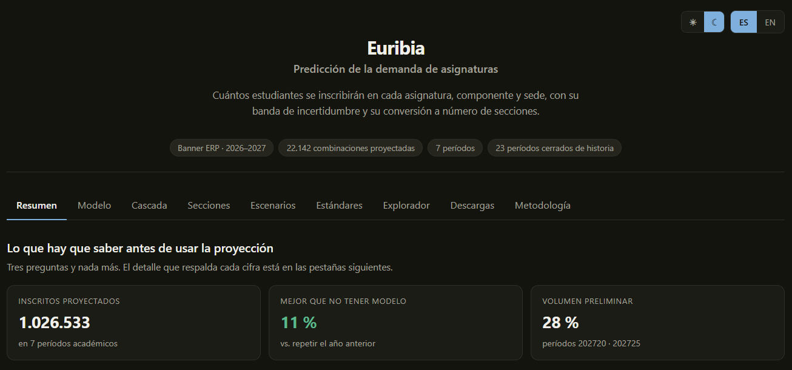
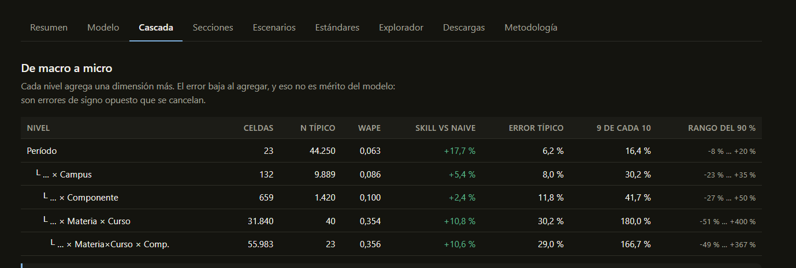
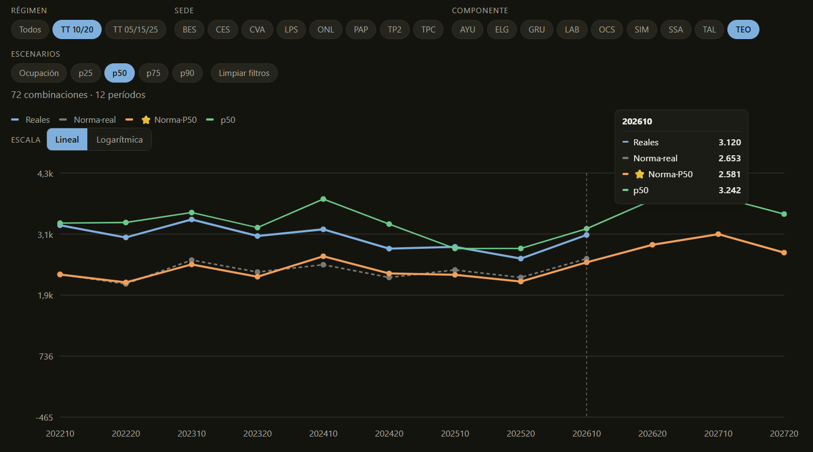
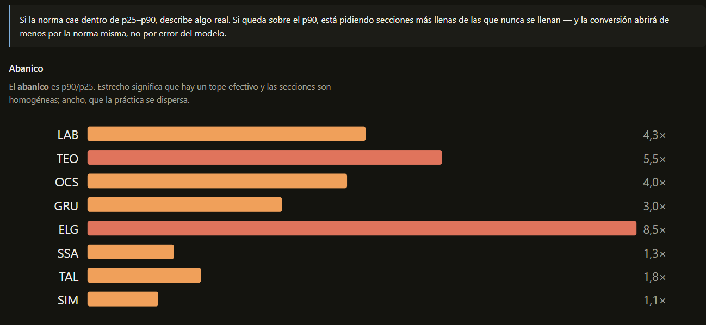
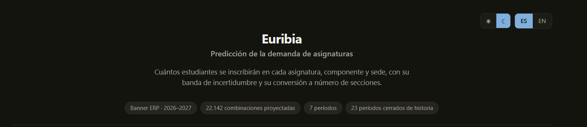

# Capturas del panel

Cinco vistas del dashboard de Euribia, en modo oscuro. El panel está en vivo:
**[abrir Euribia](https://huggingface.co/spaces/diegoevans2-arch/proyeccion-demanda-asignaturas)**.

---

### 1 · Resumen ejecutivo

Las tres cifras que un decisor necesita antes de tocar nada: cuánto se proyecta,
cuánto mejor es que no tener modelo, y qué proporción del volumen es preliminar.

> El **11 %** aparece siempre como *«vs. repetir el año anterior»*. Ninguna métrica
> de error se muestra sin la vara contra la que se mide.

---

### 2 · Cascada de agregación

El mismo pronóstico visto con distinto zoom: cinco niveles, del período completo a
la asignatura individual, cada uno con su WAPE, su skill contra el naive, su error
típico y el rango que contiene 9 de cada 10 casos.

> Es la tabla que convierte una debilidad en instrucción de uso: **el total se
> presupuesta con el modelo, la asignatura se revisa con la sede**. El error sube de
> 6,2 % a 29,0 % al bajar de grano, y la nota advierte que el WAPE que baja al
> agregar no es mérito del modelo — son errores de signo opuesto que se cancelan.

---

### 3 · Escenarios de programación

Secciones por período: lo realmente abierto contra cuatro criterios de
dimensionamiento distintos, filtrable por régimen, sede y componente. La línea
punteada marca dónde termina el histórico y empieza la proyección.

> Permite discutir políticas de apertura con evidencia —cada criterio contrastado
> contra lo que pasó— en vez de en abstracto.

---

### 4 · Estándares de ocupación

El **abanico** (p90/p25) mide la dispersión real de ocupación por componente.
Estrecho significa que hay un tope efectivo y las secciones son homogéneas; ancho,
que la práctica se dispersa.

> Aquí se ve el hallazgo central de la conversión: si la norma queda sobre el p90
> observado, **está pidiendo secciones más llenas de las que nunca se llenan**, y
> abrirá de menos por la norma misma, no por error del modelo.

---

### 5 · Cabecera

Identidad del panel y los cuatro indicadores de alcance: ERP de origen, volumen
proyectado, horizonte y profundidad del histórico usado para validar.

---

**[← Volver al README del proyecto](../README.md)**

