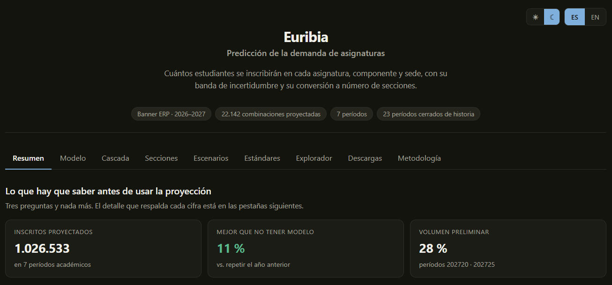
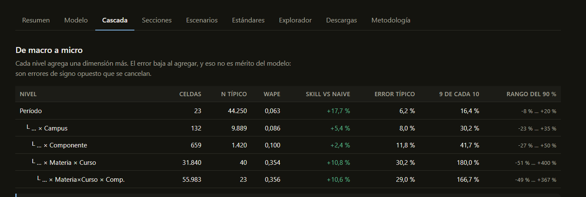
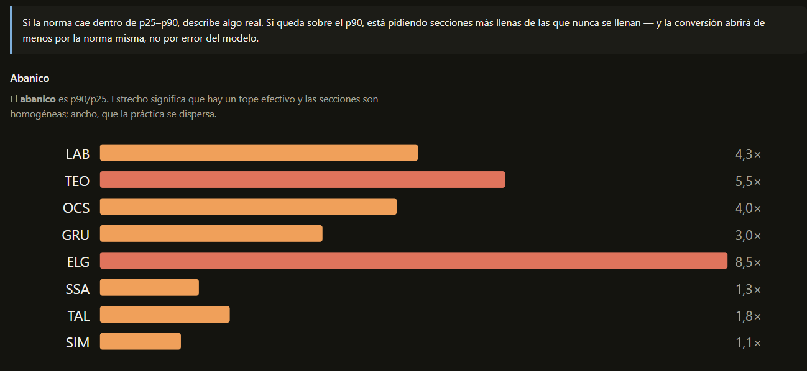
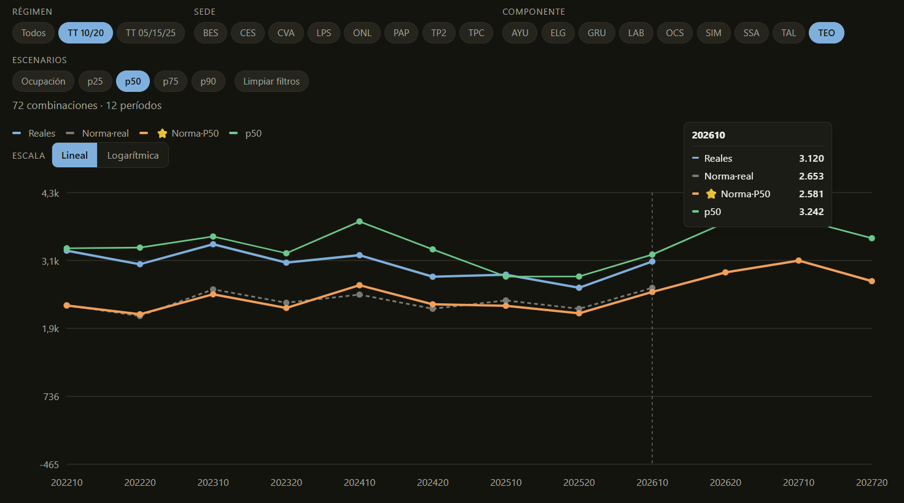

<div align="center">

# === Euribia ===

**Forecasting de demanda de asignaturas sobre ERP Banner**

Proyecta cuántos estudiantes se inscribirán en cada asignatura, componente y sede,
entrega la banda de incertidumbre y la convierte en número de secciones a abrir.


</div>



---

## El resultado, primero

Medido sobre **55.983 celdas** de 23 períodos académicos cerrados (2022–2026),
que representan **2.612.770 inscritos**.

| Métrica | Seasonal naive | **Euribia** | Lectura |
|---|---:|---:|---|
| **WAPE** | 0,398 | **0,356** | Desvío total sobre el volumen real, ponderado por tamaño |
| **MAE** | 18,6 | **16,6** | Inscritos de error por celda |
| **MASE** | 1,000 | **0,894** | Bajo 1 le gana al baseline |
| **Skill score** | — | **+10,6 %** | `1 − WAPE_modelo / WAPE_vara` |
| **R²** | 0,653 | **0,670** | |
| Sesgo | — | +4,2 % | Sobreproyecta en el agregado; medido y descontable |
| Cobertura P10–P90 | — | 75,2 % | Objetivo nominal 80 % |

<div align="center">

### 🔗 &nbsp; [**Explorar el panel en vivo**](https://huggingface.co/spaces/diegoevans2-arch/proyeccion-demanda-asignaturas) &nbsp; 🔗

Nueve módulos · bilingüe ES/EN · las 22.142 combinaciones filtrables y descargables

</div>

---

## El problema

Cada período académico hay que decidir **cuántas secciones abrir** para decenas de
miles de combinaciones de asignatura, componente y sede. En la mayoría de las
instituciones esa decisión se toma con criterio experto y planillas.

Una sección de más es presupuesto comprometido. Una de menos son estudiantes sin
cupo y un problema de gestión académica en pleno período. **El error cuesta
distinto según el lado**, y hasta ahora nadie medía cuánto.

### Por qué es portable

El pipeline consume seis extracciones que **cualquier instalación de Banner ya
tiene**: inscripción histórica por NRC, catálogo de asignaturas, mallas
curriculares, índices de reprobación y las tablas de nivel académico
(`SCRLEVL` / `STVLEVL`).

La nomenclatura de períodos (`YYYYTT`), los códigos de componente
(`TEO`, `LAB`, `AYU`, `TAL`…) y la estructura `materia + curso` son **estándar del
ERP**, no de una institución concreta. Cambiando el origen de los CSV, el pipeline
corre en cualquier universidad que opere sobre Banner.

---

## Arquitectura de datos · el pipeline

Seis fuentes crudas → una sábana modelable de **163.954 × 61**. El 60 % del código
existe para resolver un solo problema: **Banner renombra la asignatura con cada
versión de malla**.

```
┌─ FUENTES (6) ────────────────────────────────────────────────────────┐
│  REPORTE_INSCRIPCIÓN_FULL          7.413.130 × 7    [385 MB]         │
│  MAESTRO_MALLAS_CATALOGO             214.490 × 38                    │
│  INDICE_REPROBACION                  131.108 × 10                    │
│  SCRLEVL · STVLEVL (nivel académico)  19.229                         │
└───────────────────────────────┬──────────────────────────────────────┘
                                ↓
┌─ BLOQUE A · NORMALIZACIÓN DE CÓDIGOS ────────────────────────────────┐
│  tabla de reglas con ranking  →  cascada de homologación             │
│  9.406 asignaturas históricas  →  7.748 códigos unificados           │
│  2.499.295 inscripciones reubicadas (33,7 %), total invariante       │
└───────────────────────────────┬──────────────────────────────────────┘
                                ↓
┌─ BLOQUE B · VARIABLE OBJETIVO ───────────────────────────────────────┐
│  grano:  PERIODO × MATERIA × CURSO × COMPONENTE × CAMPUS             │
│  INSCRITOS = count(RUT)   ·   n_secciones = nunique(NRC)             │
└───────────────────────────────┬──────────────────────────────────────┘
                                ↓
┌─ BLOQUE C · ENRIQUECIMIENTO ─────────────────────────────────────────┐
│  nivel académico · reprobación · atributos de malla · imputación     │
└───────────────────────────────┬──────────────────────────────────────┘
                                ↓
┌─ BLOQUE D · FEATURES TEMPORALES ─────────────────────────────────────┐
│  10 lags: estacionales (mismo TT, k años) · rolling 3y · cronológico │
│  ⚠️  el corazón del anti-leakage                                      │
└───────────────────────────────┬──────────────────────────────────────┘
                                ↓
┌─ BLOQUE E · CONVERSIÓN A OFERTA ─────────────────────────────────────┐
│  estándar de programación (con lag) · percentiles p25/50/75/90       │
└───────────────────────────────┬──────────────────────────────────────┘
                                ↓
        DEMANDA_PROCESADA.parquet   163.954 × 61   ·   28.996 series
```

### La homologación es el proyecto

Sin unificar códigos, la serie de una misma asignatura queda partida en fragmentos
de dos o tres períodos: **no hay historia que modelar**. El algoritmo de cascada
descubrió que las equivalencias en las mallas son **simétricas, no direccionales**,
y resuelve el ranking por versión de malla con diferimiento.

| | |
|---|---:|
| Inscripciones reubicadas | **2.499.295** (33,7 %) |
| Reducción de códigos | 9.406 → **7.748** (−17,6 %) |
| Invariante verificada | `Σ INSCRITOS` idéntico antes y después |

---

## Arquitectura del modelo · cinco capas

```
┌─ CAPA 1 · BASE ──────────────────────────────────────────────────────┐
│  ins_lag_1y  (seasonal naive)                                        │
│  aporta el NIVEL — la extrapolación que los árboles no saben hacer   │
└───────────────────────────────┬──────────────────────────────────────┘
                                ↓
┌─ CAPA 2 · CATBOOST ──────────────────────────────────────────────────┐
│  target = log1p(y) − log1p(naive)                                    │
│  aprende la CORRECCIÓN relativa al naive, centrada en 0              │
│  47 features · walk-forward de 7 orígenes                            │
└───────────────────────────────┬──────────────────────────────────────┘
                                ↓
┌─ CAPA 3 · BLEND ─────────────────────────────────────────────────────┐
│  p = w · p_catboost + (1−w) · naive,  con w calibrado                │
│  controla la DISTRIBUCIÓN, no el nivel                               │
└───────────────────────────────┬──────────────────────────────────────┘
                                ↓
┌─ CAPA 4 · RECONCILIACIÓN ────────────────────────────────────────────┐
│  escala ∀ filas para que  Σ = Σ(naive) × 0,9878                      │
└───────────────────────────────┬──────────────────────────────────────┘
                                ↓
┌─ CAPA 5 · SUPERVIVENCIA ─────────────────────────────────────────────┐
│  P50_ESPERADO = P50 × P(se dicte)      AUC 0,826                     │
└──────────────────────────────────────────────────────────────────────┘
```

### Por qué corrección y no nivel

> *Un árbol nunca predice fuera del rango que vio en entrenamiento.*

Con la matrícula creciendo, la primera versión —que predecía el nivel
directamente— se aplanaba en el techo histórico y **perdía contra el seasonal naive
por un 21 %**, con el sesgo degradándose año a año. Reformular el target como
corrección en escala logarítmica resolvió el problema de raíz: el naive aporta el
nivel, el modelo solo aprende cuánto corregirlo.

### La elección de familia se midió, no se supuso

| Modelo | WAPE |
|---|---:|
| **CatBoost** 🏆 | **0,346** |
| LightGBM | 0,371 |
| XGBoost | 0,391 |

El **ensemble no mejoró al ganador**: promediar con modelos peores arrastra al
bueno. También se descartó el clustering — un silhouette de 0,97 resultó ser un
espejismo que aislaba 17 outliers de 13.000 series.

---

## Validación e incertidumbre

| Decisión | Por qué |
|---|---|
| **Walk-forward con 7 orígenes** | En series temporales el corte cronológico es lo único que evita *leakage*. Nunca validación cruzada aleatoria (Tashman, 2000) |
| **Conformal quantile regression** | Bandas P10–P90 con cobertura **calibrada y medida**, no supuesta (Romano et al., 2019) |
| **MASE como métrica transversal** | Es la única comparable entre niveles de agregación (Hyndman & Koehler, 2006) |
| **Reconciliación jerárquica** | El total se impone sobre la suma de las partes (Wickramasuriya et al., 2019) |

### Calibración de las bandas, medida contra su nominal

| | Objetivo | Real |
|---|---:|---:|
| Cobertura P10 | 10 % | 20,1 % |
| Cobertura P50 | 50 % | 63,0 % |
| Cobertura P90 | 90 % | 93,3 % |
| **Intervalo P10–P90** | **80 %** | **75,2 %** |

El intervalo queda **apretado**: cubre menos de lo que promete. Está medido y
declarado — que es la diferencia entre una banda útil y una decorativa.

---

## Resultados

### El error según el nivel de agregación

Es una encuesta nacional: acierta el país con ±3 puntos y se equivoca feo por
comuna, porque ahí preguntó a 20 personas. El mismo pronóstico, distinto zoom.



**La conclusión operativa:** el total se presupuesta con el modelo; la asignatura
individual se revisa con la sede. La tabla no esconde la debilidad — la convierte
en instrucción de uso.

### De inscritos a secciones — dónde vive realmente el error

| | Secciones | vs. real |
|---|---:|---:|
| Secciones **reales** abiertas | 168.974 | — |
| La norma con los **inscritos reales ya sabidos** | 123.335 | **−27,0 %** |

La segunda fila **no usa el modelo**: aplica la norma de ocupación a la demanda
verdadera. Y aun así abre un 27 % menos secciones de las que se abrieron.

> **La mayor parte del error de conversión no viene del pronóstico, viene del
> estándar de programación.** Separar ambas fuentes de error fue lo que permitió
> demostrarlo, y abre una conversación que no estaba en la agenda.



El **abanico** (p90/p25) mide la dispersión real de ocupación por componente. Si la
norma cae sobre el p90, está pidiendo secciones más llenas de las que nunca se
llenan.

### Escenarios de programación, contrastados contra lo que pasó



Cada línea es una política de dimensionamiento distinta, evaluada contra las
secciones realmente abiertas. Permite discutir criterios con evidencia en vez de en
abstracto.

---

## El panel

<div align="center">

## [▶ &nbsp; Abrir Euribia en vivo](https://huggingface.co/spaces/diegoevans2-arch/proyeccion-demanda-asignaturas)

[](https://huggingface.co/spaces/diegoevans2-arch/proyeccion-demanda-asignaturas)

</div>

Dashboard estático **bilingüe (ES/EN)**, sin dependencias externas: HTML, CSS y
JavaScript plano. Sin CDN, sin build step, sin servidor.

| Módulo | Contenido |
|---|---|
| **Resumen** | Las tres preguntas ejecutivas y las advertencias de uso |
| **Modelo** | La vara primero, luego las métricas, la cobertura real y el checklist de las seis reglas de oro del forecasting |
| **Cascada** | El error y el skill en cinco niveles de agregación |
| **Secciones** | Seis criterios de conversión y el reparto del error entre modelo y estándar |
| **Escenarios** | Secciones por período con filtros de régimen, sede, componente y percentil |
| **Estándares** | Ocupación observada contra la norma, por componente |
| **Explorador** | Las 22.142 combinaciones, buscables y filtrables |
| **Descargas** | CSV y JSON generados en el navegador |
| **Metodología** | Qué pregunta responde cada métrica y cómo leerla |

Los datos van en **formato columnar** (`{a:[1,3],b:[2,4]}` en vez de
`[{a:1},{a:3}]`): con 22 mil filas, eso ahorra megas de nombres de campo repetidos.

---

## Límites conocidos

Un modelo sin límites declarados es un modelo que no se auditó.

| Límite | Detalle |
|---|---|
| **Asignaturas nuevas** | Entre el 19 % y el 29 % de las series de cada período no existían antes. Sin historia no hay lag del cual partir |
| **No es proyección de matrícula** | Proyecta lo que harán las asignaturas **que ya existen**. Compararlo contra una meta institucional lleva a concluir, erróneamente, que sub-proyecta |
| **Horizonte 2** | Al encadenar una predicción sobre otra, el WAPE se degrada de 0,414 a 0,482 (**+16,5 %**). El 28 % del volumen proyectado está en ese régimen |
| **Concentración del error** | El 10 % peor de las celdas concentra el **54 %** del error absoluto. Es una lista corta, atacable con revisión manual |
| **Las secciones no cuadran al agregar** | Sumar las columnas da la suma de dimensionamientos individuales, cada uno calculado como si su asignatura se dictara |
| **`P50` vs `P50_ESPERADO`** | El primero dimensiona, el segundo suma. Confundirlos cuesta un 9,7 % en el agregado |
| **Sin monitoreo de drift** | El modelo no avisa si el comportamiento cambia bajo sus pies |

---

## Estructura del repositorio

```
Euribia/
├── Notebooks/
│   ├── PIPELINE_PROYECCION_ASIGNATURAS.ipynb    6 fuentes → sábana modelable
│   ├── MODELO_ML_PROYECCION_ASIGNATURAS.ipynb   el modelo de cinco capas
│   └── Análisis_deploy_modelo.ipynb             auditoría post-producción
├── Documentación/
│   ├── RESUMEN_EJECUTIVO.md                     el proyecto en 10 minutos
│   ├── DOCUMENTO_TECNICO_FUNCIONAL_PIPELINE.md  la sábana, celda por celda
│   ├── DOCUMENTO_TECNICO_FUNCIONAL_MODELO_ML.md el modelo y sus decisiones
│   └── DICCIONARIO_ENTREGABLES_PROYECCION.md    los CSV campo por campo
├── hf_space/                                    el panel (HTML/CSS/JS + datos)
└── Imagenes/
```

### Por dónde entrar

| Si eres… | Empieza por |
|---|---|
| **Ingeniero de datos** | [`DOCUMENTO_TECNICO_FUNCIONAL_PIPELINE.md`](Documentación/DOCUMENTO_TECNICO_FUNCIONAL_PIPELINE.md) — linaje, invariantes y guards celda por celda |
| **Data scientist** | [`DOCUMENTO_TECNICO_FUNCIONAL_MODELO_ML.md`](Documentación/DOCUMENTO_TECNICO_FUNCIONAL_MODELO_ML.md) — features, validación y experimentos descartados |
| **Con poco tiempo** | [`RESUMEN_EJECUTIVO.md`](Documentación/RESUMEN_EJECUTIVO.md) — todo lo anterior, condensado |
| **Quien consuma los datos** | [`DICCIONARIO_ENTREGABLES_PROYECCION.md`](Documentación/DICCIONARIO_ENTREGABLES_PROYECCION.md) — cada campo con recetas SQL |

---

## Volumetría

| Objeto | Volumen |
|---|---|
| Inscripciones de origen | **7.413.130** · 131 períodos (2015–2026) |
| Sábana analítica | **163.954** × 61 · **28.996** series |
| Celdas medidas en backtest | 55.983 · 23 períodos |
| Entregable de proyección | **22.142** filas · 7 períodos |
| Serie real vs. proyectado | 78.125 filas |
| Cobertura | 8 sedes · 9 componentes |

---

## Stack

`Python 3.11` · `pandas` · `NumPy` · `CatBoost` · `scikit-learn` · `PyArrow/Parquet`
· `matplotlib` · `seaborn` · `Jupyter` · `Hugging Face Spaces`

Todo open source. Sin licencias, sin servicios gestionados, sin build step en el
panel.

---

## Referencias

- Hyndman, R. J. & Koehler, A. B. (2006). *Another look at measures of forecast accuracy*. **IJF** 22(4), 679–688.
- Tashman, L. J. (2000). *Out-of-sample tests of forecasting accuracy: an analysis and review*. **IJF** 16(4), 437–450.
- Hyndman, R. J. & Athanasopoulos, G. (2021). *Forecasting: Principles and Practice* (3.ª ed.). OTexts.
- Prokhorenkova, L. et al. (2018). *CatBoost: unbiased boosting with categorical features*. **NeurIPS** 32.
- Romano, Y., Patterson, E. & Candès, E. (2019). *Conformalized Quantile Regression*. **NeurIPS** 33.
- Wickramasuriya, S. L. et al. (2019). *Optimal forecast reconciliation for hierarchical time series*. **JASA** 114(526).

---

<div align="center">

**Diego Evans Pérez Paz** · Ingeniería de Datos y Machine Learning

</div>
